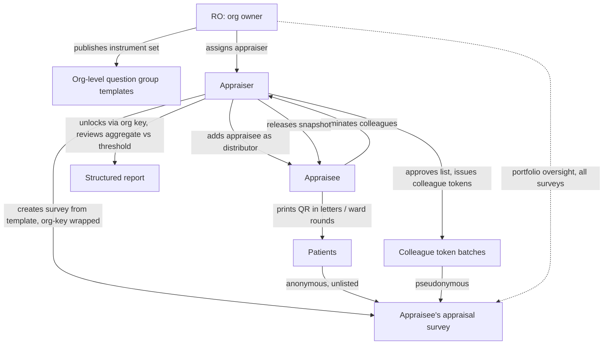

# Appraisal workflow (GMC-style 360 appraisal) — implementation plan

> **SCRATCH DOCUMENT.** This is a working design discussion, not a shipped
> reference. It will be removed (or its content absorbed into the live docs
> listed in §12) once the work is planned into issues. Do not link to it from
> other docs.
>
> **Resuming in a fresh session:** this document is self-contained — read it
> fully before writing code. Start from §15 (phasing); phase 1 is the
> template-publication fix (§7.1–§7.3). The only open decision is Q3
> (structured report content, supplied by the author when the report
> generator is designed). Repo conventions (tests, lint, Docker) come from
> `AGENTS.md`, which is loaded automatically.

## 1. Summary

Offer CheckTick to designated bodies (hospital appraisal departments, ROs)
to run GMC-style patient and colleague feedback as part of medical
appraisal. The workflow is:

- The **Responsible Officer (RO)** holds the organisation account and has
  oversight of every appraisal.
- Each **appraiser** looks after a caseload of **appraisees** (clinicians).
- Each appraisee distributes feedback instruments to **patients** (anonymous,
  single QR) and **colleagues** (nominated raters, token-based).
- Responses are encrypted at rest. The **appraiser** — not the appraisee —
  can read results, reviews the aggregate, and releases a structured report
  to the appraisee. The RO sees everything.

This is **not a new survey layout**. It is an organisation-tier workflow
layered on existing primitives: respondent categories, org-level published
question groups, token batches, unlisted publication, receipt tokens, and
the org master key. The core platform (encryption as standard, anonymous
completion, redaction, data-subject rights) is unchanged.

## 2. Locked decisions

Decisions already made in discussion. Recorded here so later sections can
reference them without re-arguing.

| # | Decision | Rationale |
|---|----------|-----------|
| D1 | **Survey ownership sits with the appraiser** (org level), not the appraisee | The appraisal is an organisational obligation. If the appraisee owned the survey they could amend results — a fraud vector. Ownership + key custody makes "the appraisee cannot alter results" a cryptographic fact, not a policy promise. |
| D2 | **Org master key wrap is the default** for appraisal surveys | Appraiser turnover must not orphan data; RO needs administrative recovery and oversight independent of any individual's credentials. `encrypted_kek_org` already exists. |
| D3 | **Patient-facing publication = one unlisted QR per appraisee** | Same workflow as current public publication; anonymous; the one-time receipt token on the thank-you page preserves the later opt-out/redaction path (`allow_response_redaction`, issue #376 — already supported for anonymous responses). |
| D4 | **Colleague-facing publication = token-based** | The appraisee nominates raters; tokens are pseudonymous so a response can be linked to a token if a serious risk requires it (§9), while aggregate reporting stays anonymous. |
| D5 | **Minimum response threshold** gates report release | Anonymity protection and report validity (GMC-style suppression). |
| D6 | **Released reports are structured snapshots** — immutable, audit-logged | Content defined per instrument; see §10 (author to supply section list). |
| D7 | **Appraisal instruments live in `docs/question-group-templates/`** | Same convention as the existing 360° colleague battery template; variants per staff group and rater audience (§7). |
| D8 | **Distributor is a general survey role**, not an appraisal concept | Other survey types need "can distribute, cannot read results" (research coordinators, clinic leads). The appraisal workflow *consumes* the role; it does not define it. |
| D9 | **One survey per appraisee per cycle** (Q1 resolved) | Patient and colleague populations are sections of one survey, separated by `required_categories`; unified report. |
| D10 | **RO co-signs any rater identification** (Q2 resolved) | Exception review is two-party: appraiser raises, RO approves before token→response linkage is revealed. |
| D11 | **Colleague nominations are cycle-scoped** (Q4 resolved) | Nominations (names/emails) are personal data retained only while the cycle is open; discarded at cycle close, leaving pseudonymous token references. Shapes the DPIA addendum and ROPA entry. |
| D12 | **Role name stays "Distributor"** (Q5 resolved) | Clearer that the role has no author responsibilities. Research coordinators may be viewers *or* distributors — the docs define the scope; no second role needed. |
| D13 | **Global instruments are curated, not self-published** | The publish-question-group UI offers a Global option that the product policy (API) reserves for administrators — see §7.1. Users submit instruments to CheckTick for review; accepted instruments ship as markdown files in `docs/question-group-templates/`. |

## 3. Role model

### 3.1 The distributor role (general, survey-level)

A new `SurveyMembership.Role.DISTRIBUTOR` — one notch below `EDITOR`:

| Capability | Distributor | Editor | Viewer |
|---|---|---|---|
| Generate token batches / QR codes | ✓ | ✓ | ✗ |
| See completion counts (responses received, not content) | ✓ | ✓ | ✓ |
| Edit questions, settings, publication | ✗ | ✓ | ✗ |
| View or export results | ✗ | ✓ | ✓ |
| Manage survey members | ✗ | ✗ | ✗ |

Notes:

- Token generation is currently gated by `require_can_edit` (`survey_tokens`
  view). The distributor role needs its own permission helper (e.g.
  `can_distribute_survey`) and the tokens view accepts owner + distributor +
  edit-level roles.
- Completion counts must come from a count-only query path — no response
  content, no demographics, no free text. This matters for the RBAC docs and
  the threat model (§12).
- The role is survey-level and survey-type-agnostic. Nothing in its
  definition mentions appraisal.

### 3.2 Appraisal roles (workflow-level, not permissions)

These are relationships, not new RBAC entries:

| Appraisal role | CheckTick realisation |
|---|---|
| Responsible Officer | Organisation owner / admin (existing `is_org_admin` oversight) |
| Appraiser | Survey **owner** of each appraisee's appraisal survey |
| Appraisee | `DISTRIBUTOR` membership on that survey |
| Patient respondent | Anonymous unlisted respondent (no seat, no login) |
| Colleague respondent | Token holder (pseudonymous) |

The appraiser↔appraisee pairing needs a lightweight record (an
"appraisal relationship": appraiser, appraisee, appraisal cycle/year,
instrument set) so the caseload UI and the RO portfolio can be built without
scrapping memberships. It should *carry* the distributor membership rather
than replace it — the membership is what the permission layer checks.

## 4. Design decision: a dedicated `/appraisal/` surface?

**Recommendation: yes — a thin vertical over general primitives.**

The workflow (caseload, creation wizard, review, release, exception review,
RO portfolio) is specific to appraisal and would clutter the general survey
UI if folded into it. But every *mechanism* underneath is general
(distributor role, org-key wrap, snapshots, thresholds, receipt tokens) and
must live in the survey core so other survey types can reuse them.

Precedent in the codebase: Delphi is a layout but `DelphiRound` is a
workflow; the diary plan separates the *trigger* from the *selection*. Same
split here:

- **General core** (usable by any survey): distributor role, org-key wrap
  option, report snapshots, minimum-response threshold, receipt tokens.
- **Appraisal vertical** (`/appraisal/`, org-scoped URLs): relationship
  records, caseload dashboard, creation wizard, review + release flow,
  exception review, RO portfolio. Gated to organisation accounts; billed at
  the Organisation tier.

This also keeps the commercial story clean: appraisal is an organisation
offering; seats are clinicians (RO, appraisers, appraisees) — patients and
colleague raters are respondents and consume no seats.

Counter-consideration (D8): because the distributor role is general, the
`/appraisal/` UI must be the only place that *creates* appraisal
relationships — nothing in the core survey pages should assume appraisal
semantics.

## 5. Survey structure per appraisee

**Recommendation: one survey per appraisee per appraisal cycle**, with two
rater populations handled by respondent categories:

- Dimensions: `rater_role` ∈ {`patient`, `colleague`} (token-resolved),
  `subject` (free text, the appraisee's name — used in report headers and
  content-block substitution).
- **Patient sections** carry no `required_categories` rule → visible to
  everyone, including unlisted respondents with no token.
- **Colleague sections** carry `required_categories: {rater_role:
  colleague}` → visible only to token holders whose batch carries that
  value (the existing 360 batch-generation action does exactly this).
- Publication: **unlisted**. Patients scan the QR (no token → patient
  sections only). Colleagues open their personal token link (→ colleague
  sections). One survey, one instrument set, unified reporting.

Why not two surveys (one patient-facing unlisted, one colleague-facing
token)? Two surveys would be needed only if the org wants different
retention, different close dates, or independently versioned instruments
per audience. The categories mechanism was designed for exactly this
single-survey pattern, and a unified report is simpler. **Decision point
Q1** (§13): confirm single-survey; fall back to two linked surveys only if
an instrument demands it.

## 6. Workflow end-to-end

1. **Setup (RO).** Org created by platform admin; RO is owner. The RO
   wizard (§7.2) adopts the appraisal instrument family from the curated
   library — unamended by default, or amended via build/outline — and
   publishes it at organisation level
   (`PublishedQuestionGroup`, `PublicationLevel.ORGANIZATION`).
2. **Creation (appraiser).** Per appraisee: create survey from the org
   template (a "create for my caseload" bulk action), subject stamped in,
   org-key wrapped (D2), appraisee added as distributor.
3. **Nomination (appraisee → appraiser).** Appraisee submits a nominated
   colleague list; appraiser checks for conflicts of interest and approves.
   Colleague token batches are issued per approved rater.
4. **Distribution (appraisee).** Patient QR (unlisted link) in letters and
   on the ward; colleague tokens sent to raters. Appraisee sees completion
   counts only.
5. **Collection.** Patients anonymous; colleagues pseudonymous; all
   responses encrypted at rest; receipt tokens on the thank-you page
   preserve the redaction path.
6. **Review (appraiser).** Unlock via org key; aggregate report behind the
   minimum-response threshold (D5); free-text review.
7. **Release (appraiser → appraisee).** Structured snapshot (D6) released
   to the appraisee; immutable; audit-logged.
8. **Oversight (RO).** Portfolio dashboard across all appraisals: status,
   response counts vs threshold, release state, appraisal dates.

## 7. Instruments

Instruments are question-group templates in `docs/question-group-templates/`
(same convention as the existing `question-group-templates-360-assessment.md`
colleague battery). The appraisal set needs variants:

- **By staff group** — doctors, nurses, AHPs, etc. Different item sets per
  group (e.g. `…-doctor-patient.md`, `…-nurse-patient.md`).
- **By rater audience within one survey** — patient-facing sections and
  colleague-facing sections are different questions in the same instrument,
  separated by `required_categories` rules (§5).

Authoring uses the existing outline grammar, including the `CATEGORIES`
block and `~ cat:<dim>:<value>` section suffixes from the respondent
categories feature, so an instrument file fully describes both populations.
The organisation publishes the approved set once; appraiser-created surveys
import from the org library, so every appraisee in a cycle answers the same
instrument — a requirement for defensible comparison and aggregation.

### 7.1 Global publication is curated, not self-serve (bug + resolution)

**The bug.** The publish-question-group workflow is internally
inconsistent about global templates:

- The **API** enforces the product policy: `publish_from_group`
  (`api/views.py`) returns 403 "Only administrators can publish global
  templates" for non-superusers (tested by
  `test_global_publication_requires_superuser`).
- The **web UI** contradicts it: `PublishQuestionGroupForm` offers
  "Global (all users)" to every user, and `can_publish_question_group`
  (`surveys/permissions.py`) permits global publication for anyone who is
  not an org VIEWER. No superuser check exists anywhere in the surveys app.

So the form advertises a capability the policy reserves for
administrators. The VIEWER rule inside `can_publish_question_group`
(blocking global publication for users who are a VIEWER in *any*
organisation) exists only to gate this path and becomes dead weight once
the option is removed.

**Resolution (D13).** Do not fix the UI to match the API — remove the
global option from the user-facing publish workflow entirely:

1. `PublishQuestionGroupForm` offers **organisation level only** (the
   individual-survey case, which today offers global-only, needs a
   decision: hide publishing until the survey is org-linked, or allow
   org-level publishing from any survey — see Q6).
2. `can_publish_question_group` drops the `global` branch and the VIEWER
   check; the API keeps its superuser guard as defence in depth.
3. Global instruments arrive **only via the curated library**: users who
   want an instrument available to all CheckTick users submit it to
   CheckTick for review (attribution, licensing, clinical
   appropriateness); accepted instruments are added as markdown files to
   `docs/question-group-templates/` and ship in a release. The existing
   front-matter format (title/description/tags/attribution) is the
   submission format.
4. Docs to update: `docs/publish-question-groups.md` (remove global from
   the user workflow, document admin-only),
   `docs/question-group-template-library.md` (add the submission-for-
   review process where it currently points users at self-publishing).

This fits the appraisal feature exactly: appraisal instruments are
**curated library templates**; the RO imports from the library and
publishes at organisation level. Nothing user-facing publishes globally.

### 7.2 Adopting a library instrument (and the RO wizard)

The obvious route — import the global template into a survey, amend,
republish at org level — is **blocked by design**: the publish view
refuses groups with `imported_from` set (the copyright guard against
re-exporting third-party instruments such as PHQ-9). Rather than weaken
that guard, the workflow gets a purpose-built action:

**"Adopt as organisation instrument"** (org admin / RO only):

- Offered on global library templates. Creates an org-level
  `PublishedQuestionGroup` directly from the template's markdown — no
  intermediate survey, so the `imported_from` guard is never engaged.
- Attribution is carried forward; if the org later amends its copy, the
  attribution notes the derivation ("based on CheckTick 360° Colleague
  Feedback Battery v1, amended").
- Amendment is optional and uses the existing builder / outline editor on
  the adopted org copy. Most organisations take the instrument unamended.
- The adoption action is org-scoped and attributed — it does not reopen
  any path to re-exporting third-party content.

**The RO wizard** (part of the `/appraisal/` vertical, §4) walks setup as
a sequence of these steps: choose the instrument family from the library
→ adopt (default: unamended) or amend via build/outline → the org-level
publication is created → proceed to caseload survey creation (§6 step 2).
Single-screen default path, advanced amend path for organisations that
tailor the instrument.

**Import stays universal.** Global templates remain importable by any
authenticated user into any survey they own — single users, teams, and
organisations. Adoption is an additional, org-scoped path for
instrument *publishers*; it does not restrict who can *use* the library.

### 7.3 UI signposting and the submission workflow

**Signposting (ships with the phase-1 fix).** Wherever global publication
used to be offered, the UI now explains the curated model instead:

- The publish dialog (org-level only) carries a note: *"Want this
  instrument available to all CheckTick users? The Question Bank is
  curated. You can submit an instrument for review if you own the
  copyright, the instrument is already openly licensed, or you are happy
  to share it without a licence."* linking to the submission process.
- The Question Bank library page gets a **"Submit an instrument"** link
  to the same process.
- The wording must make the licence position explicit: global publication
  is only possible where copyright already permits it (openly licensed,
  out of copyright) or the submitter is the rights holder and happy to
  share without restriction. Third-party instruments without permission
  are rejected at review.

**Submission workflow (recommended: email-first, GitHub as alternative).**
The audience is NHS organisations, not developers, so the primary channel
should be the lowest-friction one:

1. **Primary — in-app mailto / support email.** The "Submit an
   instrument" link opens a pre-addressed email to CheckTick support
   with the submission checklist in the body. The submitter attaches the
   instrument as a markdown file using the library front-matter format
   (title, description, tags, attribution: authors, citation, DOI/PMID,
   licence, year) plus a one-line rights declaration: *"I confirm I hold
   the rights to share this instrument, or it is already openly licensed,
   and I am happy for CheckTick to publish it in the Question Bank."*
   Email keeps the submission private during review — important when the
   submitter is unsure of their licence position.
2. **Alternative — GitHub issue** on the public repo, for open-source
   contributors who prefer it. Note in the docs that an issue posts the
   instrument publicly, so it is only appropriate when the rights position
   is already clear.
3. **Review checklist** (CheckTick side, before the file lands in
   `docs/question-group-templates/`): rights/licence verified; attribution
   complete; items checked for clinical appropriateness; outline-grammar
   validity (imports cleanly, including `CATEGORIES` blocks where used);
   language and accessibility review. Accepted files ship in the next
   release and appear in the library automatically.
4. **Rejection path:** the submitter is told why (rights, quality, or
   scope) — no silent drops.

Docs to carry this: `docs/question-group-template-library.md` (the
submission section replaces the current pointer to self-publishing) and
`docs/publish-question-groups.md` (global marked admin-only/curated).

**Decision point Q6 — resolved.** The removal only affects the *publish*
form; *importing* global templates is unchanged for single users, teams,
and organisations. The leftover edge case — a personal (non-org) survey's
publish dialog having no option to offer — is resolved by hiding the
publish action on non-org surveys with guidance ("link this survey to an
organisation to publish templates"): org-level publishing needs an
organisation to publish *to*, so the action is meaningless there.

## 8. Encryption and key management

- Every appraisal survey encrypts responses at rest;
  `respondent_audience` is declared at creation (patient sections →
  whole-response encryption).
- **Org-key wrap is the default (D2).** The KEK is wrapped with the org
  master key; the appraiser's personal unlock (password/OIDC) may be added
  as a convenience path but is never the only path.
- The appraisee (distributor) holds no key path. "Cannot read results" is
  enforced by key custody, not UI.
- **Appraiser turnover:** the RO (org admin) recovers via the org key and
  re-wraps to the incoming appraiser. No data orphaning.
- Audit: every unlock, results view, export, and release is logged
  (`AuditLog`); no response content in logs (house logging rules apply).

## 9. Serious-risk disclosure (colleague identification)

Colleague tokens are pseudonymous: the response↔token linkage exists in the
data model. Normally reporting aggregates and suppresses. When a response
indicates a serious risk (patient safety, fitness to practise), the
appraiser and/or RO may need to identify which nominated rater gave it.

Design:

- **Default state:** the reporting layer never shows token→response
  linkage. Identification is a separate, explicit **exception review**
  action, not a view toggle.
- **Hidden from the appraisee by construction:** the appraisee has no
  results access at all (D1) — nothing to hide behind a flag.
- **Two-party control (recommended):** the appraiser raises an exception
  review; the RO co-signs before the linkage is revealed. This protects the
  appraiser as well as the process, and matches the RO's ultimate
  accountability. **Decision point Q2** (§13): co-sign vs appraiser-alone.
- **Fully audited:** who requested, who approved, which response, when,
  why. The disclosure is recorded on the appraisal record so the released
  report can reference that an exception review occurred (content of the
  disclosure stays with the appraiser/RO).
- No crypto change required — this is a permission + audit feature over the
  existing pseudonymous linkage.

## 10. Structured released reports

Released reports are **snapshots**: generated at release time, stored
immutably, visible to the appraisee as-shared, visible to the RO, and
referenced by audit log. Regeneration after release is not possible; a
correction means a new version linked to the old.

Structure is per-instrument and the **author will supply the required
sections** — placeholder skeleton for now:

- Appraisal metadata: appraisee, appraiser, RO, cycle, instrument set +
  version, response counts per rater population, threshold status.
- Quantitative results per section (with suppression applied below
  threshold).
- Qualitative themes from free text (aggregated; no verbatim quotes below
  the anonymity threshold).
- Exceptions: whether any exception review occurred (existence only).
- Release block: released by, released to, date, snapshot version.

**Decision point Q3:** author to provide the definitive section list per
instrument family before the report generator is built.

## 11. Dashboard and surveys page changes

`survey_list` currently groups access as owned / team / organisation /
shared, built from `SurveyMembership` (roles creator/editor/viewer).
Changes:

- Add `DISTRIBUTOR` to `SurveyMembership.Role`. The existing membership
  loop (step 4) then surfaces these surveys automatically; the work is in
  the derived flags (`can_edit=False`, `can_manage=False`) and a distinct
  **"Distributing"** display group so the appraisee's view is honest about
  what they can do.
- The tokens page (`survey_tokens`) accepts distributor access; results,
  export, and edit views do not.
- **Auto-redirect guard:** the "pure participant" redirect (no owned
  surveys + live invite → take the survey) must not swallow users whose
  only access is a distributor membership — check distributor memberships
  alongside ownership before redirecting.
- The `/appraisal/` caseload view is the primary surface for appraisees and
  appraisers; the general surveys page remains the fallback list.

## 12. RBAC and documentation impact

A new role and a new workflow touch the permission story in several places.
Checklist of docs to update when this ships (not now — this is a scratch
plan):

**docs/**
- `authentication-and-permissions.md`, `user-management.md` — distributor
  role definition and capability table.
- `surveys.md`, `publish-and-collection.md` — distributing surveys,
  completion counts, tokens-page access for distributors.
- `encryption-for-users.md`, `encryption-technical-reference.md`,
  `key-management-for-administrators.md` — org-key wrap as default for
  appraisal surveys; re-wrap on appraiser turnover.
- `reporting-and-exports.md` — minimum-response thresholds, report
  snapshots, exception review.
- `question-group-template-library.md`, `question-group-templates-index.md`
  — appraisal instrument families and variants; the submit-for-review
  process and signposting copy (§7.3).
- `billing-and-subscriptions.md`, `pricing-summary.md` — appraisal as an
  Organisation-tier offering (seats = clinicians only).
- `docs/README.md` index entries for whatever graduates out of this plan.

**docs/compliance/**
- `access-control.md`, `roles-and-responsibilities.md` — distributor role,
  appraiser/appraisee/RO accountability model.
- `record-of-processing-activities.md`, `data-flow-mapping.md` — new
  processing: colleague nomination data, pseudonymous rater linkage,
  exception review disclosures.
- `dpia-survey-platform.md` — DPIA addendum for appraisal processing
  (special category context: health/professional data, identified-rater
  disclosure path).
- `risk-register.md` — new risks: distributor over-scoping, exception
  review misuse, appraiser turnover key handling.
- `security-review-log.md` — record the design review for this feature
  (threat model: distributor role, org-key default, disclosure path).
- `access-audit-logs.md` — unlock/view/release/exception events.

**docs/clinical-safety/**
- DCB0129 hazard log entry: hazard "identified rater disclosure" and
  "distributor mis-scoped access", with the two-party control and audit
  trail as mitigations.

## 13. Decision points — status

- **Q1 — single survey per appraisee:** ✅ resolved (D9).
- **Q2 — exception review control:** ✅ resolved (D10) — RO co-sign.
- **Q3 — report content:** ⏳ open — author to supply the structured
  report section list per instrument family when the report generator is
  designed (§10 stays a placeholder until then).
- **Q4 — nomination retention:** ✅ resolved (D11) — cycle-scoped,
  discarded at cycle close.
- **Q5 — role naming:** ✅ resolved (D12) — "Distributor", scope defined
  in the docs.
- **Q6 — publish action for non-org surveys:** ✅ resolved (§7.1) —
  hidden with guidance; importing global templates is unaffected.
- **Q7 — adoption vs import-then-republish:** ✅ resolved (§7.2) — the
  `imported_from` copyright guard stays; orgs adopt library instruments
directly via a dedicated org-scoped action, amendment optional.

## 14. Out of scope

- Any new survey layout enum value — 360/appraisal remains a pattern on
  respondent categories (per the respondent-categories plan).
- Changes to encryption-at-rest defaults for non-appraisal surveys.
- **Multi-year appraisal portfolios.** Most hospitals run their own
  appraisal platform; the released report is uploaded into it as part of
  the appraisal documentation. CheckTick's scope is one appraisal cycle's
  feedback and its report — not a career portfolio.
- **Non-UK markets.** The workflow is designed for NHS appraisal
  (GMC-style RO/appraiser/appraisee). Other jurisdictions would need
  their own review.
- Translation of appraisal instruments (language variants follow the
  existing survey-translation mechanism, already supported).
- Self-serve global template publication (removed — see §7.1).

## 15. Rough phasing

1. **Template publication fix (standalone, ships first):** remove the
   global option from `PublishQuestionGroupForm` and
   `can_publish_question_group`; keep the API superuser guard; add the
   signposting copy and the "Submit an instrument" entry point (§7.3);
   document the submit-for-review process (Q6 resolved in §7.1).
2. **Core primitives:** distributor role + permission helpers + tokens-page
   access + dashboard grouping; org-key wrap default option.
3. **Appraisal vertical:** relationship model, creation wizard, caseload
   view, RO portfolio.
4. **Reporting:** thresholds, structured snapshot generation (content per
   Q3), release flow, audit events.
5. **Exception review:** two-party disclosure + audit.
6. **Instruments:** author the doctor/nurse instrument families in
   `docs/question-group-templates/`; the adopt-as-org-instrument action
   (§7.2) and the RO wizard's instrument step.
7. **Docs/compliance sweep:** the checklist in §12; delete this scratch
   document.
