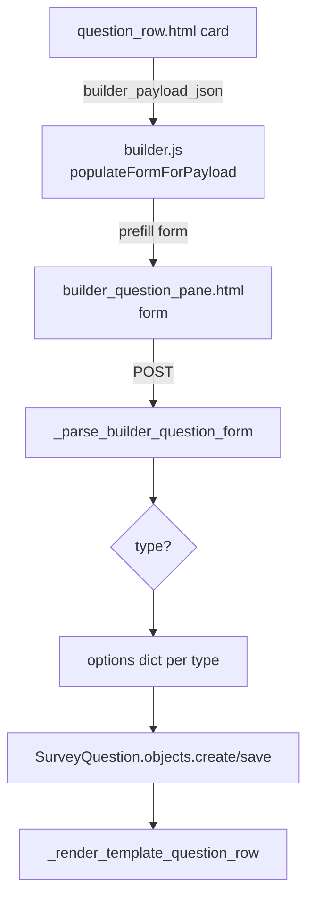

Technical reference for the survey builder. For the user-facing guide, see
[Getting Started](getting-started.md) and [Surveys](surveys.md); for the
outline grammar the builder imports from, see
[Import](import.md).

## Overview

The builder is a server-rendered HTMX app: every mutation (create, edit,
copy, delete, reorder) POSTs to a Django view that re-renders an HTML
fragment and swaps it into the page. There is no client-side state machine —
`builder.js` only toggles form sections per selected type and pre-fills the
form for edits from a JSON payload embedded in each card.

## Routes and views

All routes live under `/<slug>/builder/...` (see `surveys/urls.py`).

| Route | View | Renders |
| --- | --- | --- |
| `/builder/` | `survey_builder` | full builder page (ungrouped questions) |
| `/builder/groups/<gid>/` | `group_builder` | per-section builder page |
| `.../questions/create` | `builder_question_create` | `questions_list.html` fragment |
| `.../questions/<qid>/edit` | `builder_question_edit` | single `question_row.html` |
| `.../questions/<qid>/copy` | `builder_question_copy` | `questions_list.html` fragment |
| `.../questions/<qid>/delete` | `builder_question_delete` | `questions_list.html` fragment |
| `.../questions/reorder` | `builder_questions_reorder` | `questions_list.html` fragment |

The `_group_` variants (`builder_group_question_edit`, etc.) are the same
flows scoped to a section; both call the same helpers. On a successful save
the single-row views re-render just the affected card via
`_render_template_question_row`; the list views re-render the whole list.

## Data flow

1. **POST contract.** Every type posts the same base fields (`text`, `type`,
   `required`, `hidden_by_default`, `group_id`) plus per-type extras. The
   parse is centralised in `_parse_builder_question_form(data)`, which
   normalises inputs per type (e.g. min/max for Likert number, labels for
   Yes/No) and returns `{"text", "type", "required", "hidden_by_default",
   "options", "dataset_key", "grid_new_rows"}`. Parse-level unit tests
   (`test_builder_question_creation.py`, `test_yesno_labels.py`) exercise it
   directly without a request.
2. **Options storage.** Each type stores its config in the `options`
   JSONField: a list of option dicts for choice questions, a single-element
   list wrapper for Likert (`[{"type": "number-scale"|"categories", ...}]`)
   and text formats (`[{"type": "text", "format": ...}]`), a dict for
   content blocks and grid stems, `[]` for long text.
3. **Edit payloads.** `_prepare_question_rendering` attaches view helpers to
   every question (`num_scale_values` for Likert radio rendering) and builds
   `builder_payload` per question via `_serialize_question_for_builder`.
   The payload is JSON-encoded with `<`, `>`, `&` escaped to Unicode escapes
   and embedded in a hidden `
` on each card.
4. **Edit mode.** The card's Edit button reads its payload div, calls
   `populateFormForPayload` (mirrors the POST contract in reverse), flips
   the form's `hx-post` to the edit URL, and switches the submit button
   label. Cancel resets via `form.reset()` and a `refresh()`.

## Per-type form toggles (`builder.js`)

`initCreateFormToggles` binds a `refresh()` that runs on every `type`,
`text_format`, and `likert_mode` change:

- Section visibility: `data-section` blocks (`text-options`, `options`,
  `likert`, `grid`, `yesno-followup`, `image-options`) are toggled per type.
  The Likert section is shared by Likert questions **and** grid column
  scales.
- The per-type explainer under the type picker is updated from the
  `TYPE_EXPLAINERS` map (keep in sync with the type radios in
  `builder_question_pane.html`).
- Render-mode radios are hidden for grids — rows always render as radios.

`populateFormForPayload` is the edit-mode mirror: it must consume every key
`_serialize_question_for_builder` emits, or edits silently drop config.

## Hidden questions

Two classes of questions never appear as top-level cards:

1. **Linked consent questions** — yesno questions created by the content
   block configure panel, marked with a `_content_block_parent` key in
   `options` (see `_is_linked_consent_question`). They render inline in the
   content block.
2. **Grid rows** — questions with `parent_id` set (see
   `_is_grid_row`).

`_prepare_question_rendering` filters both out of the builder list and
attaches grid rows to their parent as `grid_rows` (plus
`grid_rows_required` for the required badge). The branching target/source
picker is built from the same pass (`all_questions_meta` filters
`parent__isnull=True`).

## Grid of sub-questions

A grid is a stem with no answer of its own plus rows sharing one scale.

- **Model.** `SurveyQuestion.parent` is a self-FK (cascade); the stem is
  `type="grid"` with `options = {"type": "grid", "row_type": "likert",
  "scale": {...}}`. Rows are real questions (currently Likert) that copy
  the shared scale into their **own** `options`, so every flat consumer —
  submission collection, partial answers, progress, analytics, CSV export —
  treats a row as an ordinary question with no special casing.
- **`clean()` guards.** Grid stems are never `required` (the flag lives on
  rows), rows cannot be grids (no nesting), and row types are limited to
  `GRID_ROW_TYPES` (likert, yesno, mc_single, mc_multi, dropdown, text,
  long_text).
- **Create.** `builder_question_create` creates stem + rows atomically;
  `*` on the stem applies `required` to every row.
- **Edit.** `_sync_grid_rows` syncs rows from the POST: existing rows post
  as `grid_row_id_<id>` inputs (a rename keeps the row — and its answers —
  intact; a missing input deletes the row), `grid_new_rows` appends, and
  the stem's scale/required/hidden flags are re-applied to every row.
  Switching a question *away* from grid deletes its rows.
- **Copy.** `_duplicate_question` clones the stem, then shifts subsequent
  orders to make room and clones the rows as a block.
- **Outline grammar.** `(grid likert number|categories)` + `###` row
  headings + `na:` — see [Import](import.md#grid-of-sub-questions). The
  parser and both export paths (`_export_survey_to_markdown`,
  `_export_question_group_to_markdown`) round-trip the scale and rows.

## Reordering

The list is a SortableJS container; `onEnd` POSTs the card order as CSV to
`questions/reorder`, which updates `order` in place. Grid rows are not
individually reorderable — their order follows the stem and is edited
within the grid's edit pane.

## Related documentation

- [Import](import.md) — the outline grammar the builder imports
- [Surveys](surveys.md) — question types (user-facing)
- [Branching and Repeats](branching-and-repeats.md) — conditions wired from
  builder cards
- [Survey Layouts (Technical)](survey-layouts-technical.md) — the organise
  page and layout config cards
